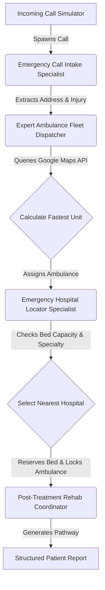

# Excalibur Crew - Emergency Ambulance Dispatch & Hospital Routing System

**Excalibur** is an AI-powered emergency response and logistics coordination system. It intelligently routes ambulances and assigns patients to hospitals in real-time. By leveraging multi-agent collaboration, live traffic matrices, and persistent state machines, Excalibur ensures patients receive the fastest and most specialized care possible.

Powered by [CrewAI](https://crewai.com), the system orchestrates a team of specialized AI agents:
- **Emergency Call Intake Specialist**: Analyzes stress-filled emergency call transcriptions to extract the patient's location, medical category, and urgency level.
- **Expert Ambulance Fleet Dispatcher**: Evaluates the real-time coordinates of the ambulance fleet, calculates traffic-aware ETAs, and dispatches the fastest available unit.
- **Emergency Hospital Locator Specialist**: Matches patients to the nearest hospital that has available bed capacity and the required medical specialization, automatically reserving beds and updating ambulance destination states.
- **Post-Treatment Medical Rehabilitation Coordinator**: Creates a customized, phased rehabilitation pathway based on the patient's initial condition and treatment timeline.

---

## Key Features

- **Concurrent Phone Line Simulator**: Simulates real-time incoming emergency calls using background daemon threads. Each call is parsed and routed in parallel to avoid blocking the main telephone line.
- **Live Traffic Integration**: Uses the Google Maps Distance Matrix / Routes API to compute real-time travel times (ETAs) and routing distances under current traffic conditions.
- **Smart Fleet & Bed Capacity Management**:
  - **Direct JSON State Tracking**: Tools read live coordinates and capacities directly from `ambulances.json` and `hospitals.json` files on disk, ensuring maximum speed, decoupling from LLM state limitations, and preventing race conditions.
  - **Dynamic Ambulance Locking (Cumulative Mission Duration)**: Ambulance occupancy time is calculated dynamically and updated in stages:
    1. First, the dispatcher tool calculates the traffic-aware travel time from the ambulance's initial location to the patient, marking the unit as occupied for that duration.
    2. Second, the hospital locator tool calculates the travel time from the patient to the chosen hospital and updates the ambulance's occupancy, adding this leg's duration.
    This guarantees that the ambulance is locked for the exact sum of times required to complete the full mission.
  - **Background Fleet Mover**: Simulates available ambulances moving dynamically through the city by shifting coordinates every 10 seconds.
  - **Background Fleet/Bed Release Checkers**: Periodically checks and frees occupied ambulances (every 30 seconds) and reserved hospital beds (every 60 seconds) once their cumulative mission/reservation durations expire.
- **Ambulance State Reset on Shutdown**: On system exit (`Ctrl+C`), a graceful shutdown hook catches the interrupt, stops all background processes, and runs a reset operation to restore all ambulance states in `ambulances.json` to `"available"`.
- **Token Usage Optimization**: Refactored to perform direct disk reads for coordinates and hospital capacities rather than interpolating large JSON structures into LLM context prompts, reducing token consumption by over 50%.
- **Robust Field Validation**: Pydantic models validate input arguments (e.g., parsing math expressions or text representations of numbers into clean integers) for all custom tools.

---

## Project Architecture

```
src/excalibur/
├── crew.py                  # Primary Excalibur crew and agent setup
├── simulator_crew.py        # Crew for generating simulated emergency calls
├── llm_config.py            # Model configurations (llama-3.3-70b-versatile, etc.)
├── config/
│   ├── agents.yaml          # Agent definitions (Analyzer, Dispatcher, Hospital Locator, Rehab)
│   ├── tasks.yaml           # Tasks configurations (Analysis, Dispatch, Hospital Search, Rehab)
│   ├── simulator_agents.yaml# Simulator agent definitions
│   └── simulator_tasks.yaml # Simulator task configurations
├── tools/
│   └── custom_tool.py       # Custom tools (Ambulance ETA, Assign Ambulance, Hospital Locator, Bed Reservation)
└── main.py                  # Main entry point with multi-threaded loops and reset hooks

ambulances.json             # Live fleet state and coordinates
hospitals.json              # Live hospital bed capacities and specializations
knowledge/                  # Local knowledge bases for agent training/reference
```

---

## Prerequisites

- **Python**: 3.10 - 3.13
- **UV**: Dependency manager (install via `pip install uv`)
- **API Keys**:
  - **GROQ_API_KEY**: For LLM inference (runs Llama-3.3-70B and Llama-3.1-8B models)
  - **GOOGLE_API_KEY**: Google Maps API with Distance Matrix and Directions enabled

---

## Installation & Setup

1. **Clone the repository** and navigate to the project directory.
2. **Install dependencies**:
   ```bash
   uv sync
   ```
3. **Configure environment variables**:
   - Rename `.env.example` to `.env`:
     ```bash
     cp .env.example .env
     ```
   - Add your API keys to `.env`:
     ```env
     GROQ_API_KEY=your_groq_key_here
     GOOGLE_API_KEY=your_google_key_here
     ```

---

## Running the System

To run the complete real-time simulator, execute from the project root:

```bash
crewai run
```

This starts the main simulation engine, which spins up the following parallel processes:
1. **Phone Line Simulator Thread**: Automatically triggers the call generator crew at randomized intervals to simulate incoming emergency calls.
2. **Background Fleet Mover Thread**: Simulates real-time coordinate shifts for available units.
3. **Background Clean-up Threads**: Monitors occupied ambulances and reserved beds, returning them to available pools as missions complete.

### Graceful Shutdown & State Reset
When you exit the running program using **`Ctrl+C` (KeyboardInterrupt)**, the system:
1. Catches the exit signal.
2. Invokes the `reset_data()` routine.
3. Resets all ambulance states in `ambulances.json` back to `"available"`, sets `"occupied_until"` and `"selected_for_hospital"` to `null`.
4. Gracefully joins and terminates all running background daemon threads.

---

## Detailed Multi-Agent Workflow



1. **Intake & Analysis Phase** (*Emergency Call Intake Specialist*):
   - Extracts exact patient address, coordinates/landmarks, injury type, and severity.
2. **Dispatch Phase** (*Expert Ambulance Fleet Dispatcher*):
   - Queries the Google Maps Traffic ETA Calculator using the extracted patient address. *This tool reads available ambulance data directly from the local JSON file.*
   - Calculates the traffic-aware travel time from each available ambulance to the patient.
   - Calls the `assign_ambulance` tool to mark the fastest ambulance as occupied for this initial leg of the trip.
3. **Routing & Hospital Selection Phase** (*Emergency Hospital Locator Specialist*):
   - Computes travel matrix from the patient's location to candidate hospitals matching the required specialty. *This tool reads hospital capacity and specializations directly from the local JSON file.*
   - Selects the optimal hospital with available bed capacity.
   - Calls the `reserve_hospital_bed` tool to decrement available beds and schedule their release.
   - Calls the `occupy_ambulance_for_hospital` tool to update the ambulance's mission, adding the second leg's travel time (patient to the hospital) to the overall ambulance occupancy duration.
4. **Rehabilitation Planning Phase** (*Post-Treatment Medical Rehabilitation Coordinator*):
   - Synthesizes intake records, response timing, and injury categories.
   - Generates a personalized recovery schedule (Acute, Subacute, Outpatient recovery) for follow-up care.

---

## Troubleshooting

- **Rate Limits (Groq API)**: If you hit rate limits, the system is designed to run silently (`verbose=False`) and relies on `llama-3.1-8b-instant` for basic tasks (e.g. analysis) and `llama-3.3-70b-versatile` only for critical decision-making agents.
- **Empty Ambulance Fleet**: If no ambulances are available, incoming calls are automatically queued / put on hold until background clean-up threads free occupied ambulances.
- **Google Maps API Failures**: Ensure that both **Distance Matrix API** and **Directions API** are enabled in your Google Cloud Console project.

---

**Built using CrewAI** | Intelligent Real-time Emergency Response System
